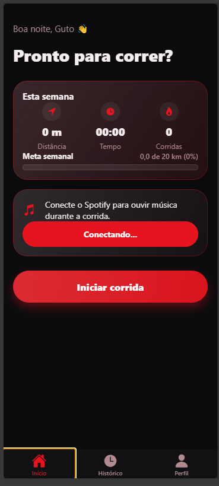

# RotaFit

Aplicativo móvel para monitoramento de corridas e caminhadas com GPS, desenvolvido com React Native, Expo e TypeScript. A aplicação integra autenticação segura via Supabase, controle de reprodução com a API do Spotify e renderização vetorial de trajetos.

<p align="center">
  
  
  
</p>

## Recursos

- **Monitoramento em tempo real**: Registro contínuo de distância, tempo decorrido, ritmo médio por quilômetro e traçado do percurso.
- **Cálculo de gasto energético**: Estimativa de calorias calculada com base no tempo de atividade e no peso corporal configurado no perfil.
- **Metas semanais**: Definição de objetivos de distância semanal com acompanhamento visual por barra de progresso.
- **Integração com Spotify**: Conexão OAuth com fluxo PKCE para exibição da faixa em reprodução e comandos de controle musical durante a corrida.
- **Visualização de rota em SVG**: Algoritmo geométrico que projeta as coordenadas geográficas em curvas Bézier suaves, sem necessidade de provedores comerciais de mapas.
- **Suporte a temas**: Modos claro e escuro persistidos no aparelho, construídos sobre o padrão visual Liquid Glass com desfoque e transparências.
- **Autenticação centralizada**: Acesso simplificado com conta Google por meio do Supabase Auth.

## Tecnologias

- **Framework**: React Native 0.76 com Expo SDK 52 (Expo Router v4)
- **Linguagem**: TypeScript com tipagem estrita
- **Backend e Banco de Dados**: Supabase (PostgreSQL 15 com Row Level Security)
- **Gerenciamento de Estado de Rede**: TanStack React Query v5
- **Armazenamento Local**: Expo SecureStore para tokens de autenticação e AsyncStorage para preferências de usuário
- **Localização e Sensores**: Expo Location com controle de precisão e filtro de saltos de GPS
- **Testes Automatizados**: Jest para regras de negócio do app e PGlite para testes do banco de dados em ambiente local isolado
- **Integracao Continua**: GitHub Actions para checagem estatica de tipos e execucao da suite de testes

## Arquitetura do Projeto

O código está organizado seguindo separação clara de responsabilidades entre regras de negócio, serviços de infraestrutura e componentes de interface.

```
rotafit/
├── app/                  # Rotas e navegação baseada em arquivos (Expo Router)
│   ├── (auth)/           # Fluxo de login e autenticação
│   ├── (app)/            # Telas autenticadas
│   │   ├── (tabs)/       # Navegação inferior (Inicio, Historico, Perfil)
│   │   └── run/          # Telas de corrida ativa e detalhe de percurso
│   └── _layout.tsx       # Provedores globais de tema, autenticação e cache
├── src/
│   ├── components/       # Componentes visuais reutilizáveis e elementos de vidro
│   ├── context/          # Provedores de contexto React (Auth, Spotify)
│   ├── hooks/            # Hooks customizados para regras de corrida e APIs
│   ├── lib/              # Clientes de serviços externos (Supabase, Spotify)
│   ├── services/         # Camada de comunicação com endpoints do banco
│   ├── theme/            # Tokens tipados de cores, espaçamentos e ThemeProvider
│   └── utils/            # Funções puras de cálculo geodésico, calorias e alertas
└── supabase/
    ├── schema.sql        # Modelagem relacional, tabelas, políticas RLS e funções RPC
    └── tests/            # Testes de integração do banco de dados executados com PGlite
```

## Como Executar

### Pré-requisitos

- Node.js 20 ou superior
- Gerenciador de pacotes pnpm instalado globalmente (`npm install -g pnpm`)
- Aplicativo Expo Go instalado em dispositivo móvel (iOS ou Android) para testes nativos, ou navegador web para execução local

### 1. Clonar e instalar dependências

```bash
git clone https://github.com/jhones04/RotaFit.git
cd RotaFit/rotafit
pnpm install
```

### 2. Configurar variáveis de ambiente

Crie um arquivo `.env` na pasta `rotafit` baseado no arquivo de exemplo `.env.example`:

```env
EXPO_PUBLIC_SUPABASE_URL=https://seu-projeto.supabase.co
EXPO_PUBLIC_SUPABASE_KEY=sua-chave-anon-publica
EXPO_PUBLIC_SPOTIFY_CLIENT_ID=seu-client-id-do-spotify
```

### 3. Configurar o banco de dados

Execute as instruções contidas em `supabase/schema.sql` no painel SQL do seu projeto no Supabase para criar a tabela de corridas, índices de busca, políticas RLS de segurança e a função agregadora `weekly_stats`.

### 4. Iniciar o servidor de desenvolvimento

```bash
pnpm start
```

Pressione `w` no terminal para abrir no navegador, ou aponte a câmera do celular para o código QR exibido no terminal utilizando o aplicativo Expo Go.

## Estratégia de Testes

O projeto conta com automação de testes cobrindo regras de negócio puras e regras de segurança do banco relacional.

| Comando | Escopo | Ferramenta |
| :--- | :--- | :--- |
| `pnpm typecheck` | Checagem estática de tipos em todo o projeto | TypeScript Compiler (`tsc`) |
| `pnpm test` | Execução completa de todos os testes unitários e de banco | Jest + Node Test Runner |
| `pnpm run test:app` | Funções de geolocalização, ritmo, calorias e máquina de estados | Jest |
| `pnpm run test:db` | Políticas RLS, restrições relacionais e agregações SQL | PGlite (PostgreSQL em memória) |

A suíte do banco de dados utiliza o PGlite para subir uma instância real do PostgreSQL dentro do processo Node.js em milissegundos, garantindo que as regras de isolamento entre usuários sejam validadas em ambiente de desenvolvimento sem dependência de containers Docker ou conexão externa à internet.

## Pipeline de Integração Contínua

O repositório possui uma rotina configurada no GitHub Actions (`.github/workflows/ci.yml`) que valida a integridade do código a cada envio para o branch principal ou abertura de pull request. O fluxo realiza a checagem de tipos estáticos e roda a suíte de testes ponta a ponta.
